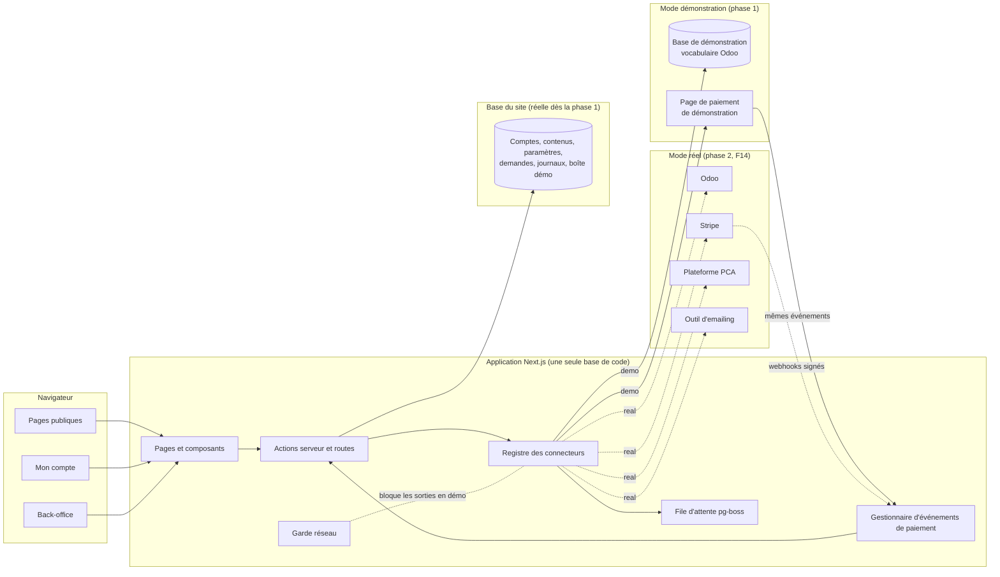
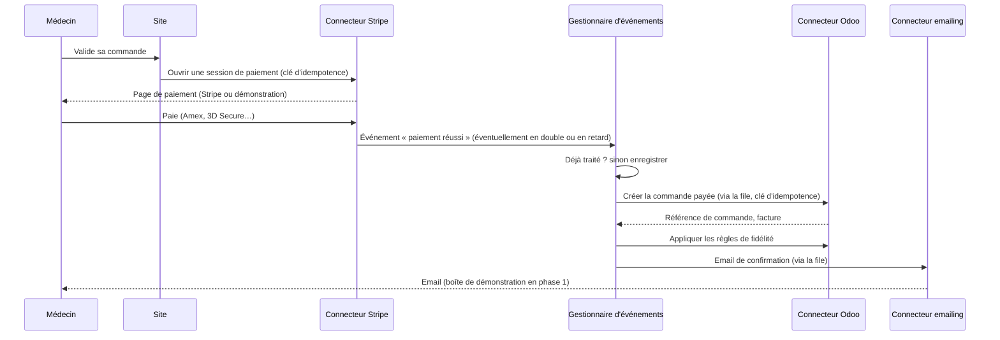

# Implementation Plan: F11 — Connecteurs et base de démonstration (phase 1)

**Branch**: `011-connecteurs-base-demonstration` | **Date**: 2026-10-14 | **Spec**: [spec.md](spec.md)

**Input**: Feature specification from `specs/011-connecteurs-base-demonstration/spec.md`

## Summary

F11 met en place **l'ossature technique de tout le site** pour la phase 1 : une application
unique (site public, « Mon compte », back-office), quatre connecteurs (Odoo, Stripe, PCA,
emailing) dotés chacun d'un mode démonstration et d'un emplacement pour le mode réel, une
base de démonstration fictive reprenant le vocabulaire d'Odoo, les simulations (paiement,
emails, accès Cloud, factures « FICTIVE »), l'écran de démonstration et la réinitialisation,
et le site de démonstration protégé.

Approche : Next.js en TypeScript, PostgreSQL avec Prisma (deux bases : site et
démonstration), un registre de connecteurs choisi par variables d'environnement, des tests de
contrat communs aux deux modes, une file d'attente dans PostgreSQL, et des contrôles
automatiques (charte, accessibilité, non-sortie réseau, performance) dans l'intégration
continue. Le détail des choix est dans [research.md](research.md).

## Technical Context

**Language/Version** : TypeScript (mode strict) sur Node.js LTS

**Primary Dependencies** : Next.js (App Router), React, Tailwind CSS 4, Prisma, Better Auth,
pg-boss (file d'attente), React Email (modèles d'emails), bibliothèque de génération de PDF ;
en phase 2 seulement : SDK Stripe, client de l'API Odoo, client de l'outil d'emailing

**Storage** : PostgreSQL géré, en France — base du site et base de démonstration
distinctes ; stockage d'objets (images, documents) chez l'hébergeur, en France

**Testing** : Vitest (unitaires et contrats), Playwright (parcours), axe-core
(accessibilité), Lighthouse CI (performance), ESLint et Stylelint (charte), script de
contrastes, garde réseau (non-sortie)

**Target Platform** : application web, navigateurs récents sur ordinateur, tablette et
mobile ; hébergement de type PaaS en France

**Project Type** : application web monolithique (une seule base de code)

**Performance Goals** : pages catalogue utilisables en moins de 2 s en profil mobile 4G
(Lighthouse) ; modification dans l'écran de démonstration visible en moins de 5 s ;
réinitialisation complète en moins d'une minute

**Constraints** : aucun appel à un service réel en phase 1 ; aucune donnée fictive vers un
service réel ; aucune donnée de patient ni de carte ; police hébergée localement (pas de
Google Fonts) ; secrets uniquement en variables d'environnement

**Scale/Scope** : quelques centaines de références, quelques centaines puis milliers de
comptes professionnels, une petite équipe (3 rôles) ; la base de démonstration compte une
quinzaine de clients fictifs

## Constitution Check

*GATE: Must pass before Phase 0 research. Re-check after Phase 1 design.*

| Principe | Vérification | Résultat |
|---|---|---|
| I. Spécialisation | F11 est de l'infrastructure ; aucune fonction de catalogue généraliste | Conforme |
| II. Simplicité et transparence | Prix HT servis par le connecteur Odoo ; aucun « prix sur demande » dans la base fictive | Conforme |
| III. Trois phases et connecteurs | Registre unique ; interfaces par service ; mode par variable d'environnement ; règle de lint interdisant tout appel direct ; base de démonstration séparée ; refus des données fictives par le mode réel ; règles d'Odoo appliquées par le connecteur de démonstration seulement ; pas de connecteur d'agenda ni de téléphonie | Conforme |
| IV. Aucune donnée patient | Aucun champ patient dans les deux bases ; connecteur PCA limité à l'identité professionnelle | Conforme |
| V. Sécurité et conformité | Aucune donnée de carte (Checkout / page de démonstration) ; factures par Odoo, « FICTIVE » en phase 1 ; secrets en variables d'environnement, scan des secrets ; double authentification de l'équipe ; journal ; site de démonstration protégé et non indexé | Conforme |
| VI. Règles paramétrables au bon endroit | Paramètres commerciaux dans la base de démonstration (futur Odoo) ; paramètres de fonctionnement dans la base du site | Conforme |
| VII. Identité visuelle | Tailwind branché sur `tokens.css` ; lint interdisant couleurs et polices en dur ; logos SVG de `docs/brand/assets` ; Inter locale | Conforme, avec une action : retirer l'`@import` Google Fonts de `docs/brand/tokens.css` |
| VIII. Accessibilité | axe-core dans les parcours ; script de contrastes | Conforme |
| IX. Ton éditorial | Textes des écrans de démonstration et emails au vouvoiement | Conforme |
| X. Incréments testables | Critères [Phase 1] / [Phase 3] ; tests de contrat communs aux deux modes ; intégration continue | Conforme |
| XI. Langue et périmètre | Interface en français uniquement | Conforme |

**Re-vérification après la conception (Phase 1)** : le modèle de données, les contrats et
le guide de validation ne créent aucun écart. Le seul point d'action reste la modification
de `docs/brand/tokens.css` (retrait de l'`@import`), prévue au premier lot de tâches. Aucune
justification de complexité n'est nécessaire.

## Architecture

### Vue d'ensemble



Les flèches pleines sont actives en phase 1 ; les flèches en pointillé sont branchées en
phase 2. Les pages n'atteignent jamais un service directement : elles passent par les
actions serveur, qui passent par le registre.

### Paiement

En mode réel, le paiement se fait sur la **page Stripe (Checkout)** : le médecin quitte un
instant le site pour payer, puis y revient. En phase 1, la page de paiement de démonstration
reproduit ce parcours.

### Flux d'une commande payée (identique dans les deux modes)



### Flux des données entre le site, Stripe, PCA et Odoo

| Donnée | Source de vérité | Sens | Phase 1 |
|---|---|---|---|
| Produits, prix, stocks, parc, barèmes, règles commerciales | Odoo | Odoo → site (lecture, cache 5 min) | Base de démonstration |
| Clients (fiche) | Odoo | Site → Odoo à la validation ; Odoo → site en lecture | Base de démonstration |
| Comptes de connexion, consentements | Site | — | Base du site |
| Commandes, abonnements | Odoo | Site → Odoo après paiement confirmé | Base de démonstration |
| Paiements | Stripe | Stripe → site par événements ; site → Odoo | Page de démonstration |
| Factures, avoirs | Odoo | Odoo → site (PDF) | PDF « FICTIVE » |
| Bons d'achat, droits d'assistance | Odoo | Odoo → site (lecture) | Calculés par le connecteur de démonstration |
| Demandes de financement et de devis | Site | Site → Odoo (copie en opportunité) | Base du site + copie démo |
| Accès Cloud | Plateforme PCA | Site → PCA (ouvrir, fermer) ; PCA → site (état) | Simulés |
| Emails et SMS | Outil d'emailing | Site → outil | Boîte de démonstration |
| Contenus, paramètres, journaux | Site | — | Base du site |

## Project Structure

### Documentation (this feature)

```text
specs/011-connecteurs-base-demonstration/
├── plan.md              # Ce fichier
├── research.md          # Choix techniques justifiés
├── data-model.md        # Base du site et base de démonstration
├── quickstart.md        # Guide de validation
├── demo-references.md   # Références produits relevées pour la base de démonstration
├── contracts/           # Contrats des connecteurs
│   ├── README.md
│   ├── common.md
│   ├── odoo.md
│   ├── stripe.md
│   ├── pca.md
│   └── emailing.md
└── tasks.md             # Créé par /speckit-tasks
```

### Source Code (repository root)

```text
app/                         # Routes Next.js (App Router)
├── (public)/                # Site public : accueil, catalogue, aide…
├── (compte)/mon-compte/     # Espace client
├── (back-office)/admin/     # Back-office (F13), dont outils de démonstration
├── demo/paiement/           # Page de paiement de démonstration (mode demo seulement)
└── api/
    └── evenements/paiement/ # Gestionnaire d'événements de paiement (Stripe et démo)

src/
├── connecteurs/
│   ├── registre.ts          # Choix de l'implémentation par variable d'environnement
│   ├── erreurs.ts           # Erreurs typées communes
│   ├── garde-reseau.ts      # Blocage des sorties en mode démonstration
│   ├── odoo/
│   │   ├── interfaces/      # catalogue, stock, clients, commandes, factures,
│   │   │                    # location, fidelite, opportunites
│   │   ├── demo/            # Implémentations sur la base de démonstration
│   │   └── real/            # Implémentations réelles (phase 2, F14)
│   ├── stripe/              # interface, demo, real
│   ├── pca/                 # interface, demo (auto et manuel), real
│   └── emailing/            # interface, demo (boîte de démonstration), real
├── domaine/                 # Règles métier propres au site (comptes, demandes…)
├── file-attente/            # Tâches pg-boss et reprises
├── emails/                  # Modèles React Email à la charte
├── ui/                      # Composants à la charte (.ec-btn, .ec-card…)
└── lib/                     # Configuration, journal, utilitaires

prisma/
├── site/schema.prisma       # Base du site
└── demo/
    ├── schema.prisma        # Base de démonstration (vocabulaire Odoo)
    └── seed/                # Jeu de données de départ, cas utiles, comptes de démo

styles/
└── theme.css                # Thème Tailwind déclaré à partir des variables --ec-*

public/fonts/inter/          # Police Inter hébergée localement

tests/
├── contract/                # Tests de contrat, un dossier par connecteur
├── unit/
├── e2e/                     # Parcours Playwright + axe-core + non-sortie réseau
└── lighthouse/              # Budgets de performance

scripts/
├── check-contrast.ts        # Contrastes des paires de tokens
└── demo-reset.ts            # Réinitialisation (aussi appelée depuis le back-office)

.github/workflows/           # Intégration continue
.env.example                 # Variables attendues, sans aucune valeur réelle
```

**Structure Decision** : application web monolithique Next.js. Les connecteurs vivent dans
`src/connecteurs/` et sont le seul endroit autorisé à parler aux services externes (règle de
lint). La base de démonstration a son propre schéma Prisma dans `prisma/demo/`, avec le jeu de
données de départ. Les dossiers `real/` restent vides en phase 1 : ils seront remplis par F14.

## Secrets et configuration

| Variable | Rôle | Phase 1 |
|---|---|---|
| `SITE_MODE` | `demo` ou `prod` (protection, bandeau, non-indexation) | `demo` |
| `CONNECTOR_ODOO`, `CONNECTOR_STRIPE`, `CONNECTOR_PCA`, `CONNECTOR_EMAILING` | `demo` ou `real` | `demo` |
| `PCA_DEMO_SUBMODE` | `auto` ou `manual` | au choix |
| `DATABASE_URL` | Base du site | requise |
| `DEMO_DATABASE_URL` | Base de démonstration | requise en phase 1 |
| `AUTH_SECRET` | Signature des sessions | requise |
| `ODOO_*`, `STRIPE_*`, `PCA_*`, `EMAILING_*` | Identifiants des services réels | **absentes** |

- `.env.example` versionné, sans valeur réelle ; `.env*` réels exclus du dépôt.
- Valeurs réelles saisies dans l'hébergeur et dans les secrets GitHub.
- Vérification au démarrage (connecteur réel incomplet → refus) et scan des secrets dans
  l'intégration continue.

## Tests automatisés

| Niveau | Outil | Phase 1 | Phase 3 (F15) |
|---|---|---|---|
| Contrats des connecteurs | Vitest | Implémentations `demo` | Mêmes tests sur `real`, environnements de test (copie d'Odoo, Stripe en mode test) |
| Parcours critiques (inscription, achat, paiement Amex, mise à disposition, facturation, fidélité, demande de financement, réinitialisation) | Playwright | Connecteurs `demo` | Services de test réels |
| Accessibilité | axe-core | Chaque page parcourue | Idem |
| Non-sortie réseau | Garde réseau + Playwright | Obligatoire | Sans objet |
| Charte | ESLint, Stylelint, script de contrastes | À chaque envoi | Idem |
| Performance | Lighthouse CI (mobile 4G) | Pages catalogue | Idem, sur l'environnement de test |
| Secrets | Scan dans l'intégration continue | À chaque envoi | Idem |

## Décisions à prendre par le porteur du projet

Formulées simplement ; chacune a une proposition par défaut.

| # | Question | Proposition | Quand |
|---|---|---|---|
| D1 | **Où héberger le site ?** | **Hébergeur français** (décidé le 2026-10-14) ; le prestataire précis (type Scalingo, Clever Cloud…) reste à choisir | Avant le premier déploiement de démonstration |
| D2 | **Le paiement se fait-il sur une page Stripe ou dans le site ?** | **Page Stripe (Checkout)** (décidé le 2026-10-14) | — |
| D3 | **Quel outil d'emailing ?** | Brevo par défaut ; **à voir** | Avant la phase 2 |
| D4 | **Quelle adresse pour le site de démonstration ?** | **`demo.explocardio.fr`** (validé le 2026-10-14) ; destinataires du mot de passe à préciser | Avant le premier déploiement |
| D5 | **Vraies références fabricant** | Relevées sur les sites DMS, Koch Évolution et SunTech : voir [demo-references.md](demo-references.md). Références fictives signalées pour Microlife, IEM, Norav, Ergoline, RAM et SunTech Tango M2 | Fait le 2026-10-14 ; à compléter si d'autres sources existent |
| D6 | **Prix de démonstration** | Aucune des sources indiquées n'affiche de prix (vente sur devis). **Prix inventés plausibles**, signalés comme tels dans la base, à remplacer avant toute présentation à un médecin (décidé le 2026-10-14) | — |
| D7 | **Version d'Odoo et API** à demander à l'intégrateur Odoo, avec la faisabilité des règles de fidélité et d'assistance (F06). | À demander | Avant la phase 2 |
| D8 | **Nelson** : la plateforme permet-elle d'ouvrir les accès automatiquement ? (sinon, mode manuel prévu) | À demander | Avant la phase 2 |

## Points d'action

- Retirer l'`@import` Google Fonts de `docs/brand/tokens.css` et fournir la police Inter dans
  le dépôt (premier lot de tâches).
- Les dossiers `real/` des connecteurs, la bascule et le banc de tests sur services réels
  relèvent de F14 et F15.

## Complexity Tracking

Aucune violation de la constitution à justifier.
